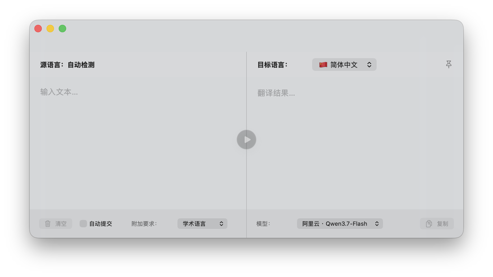
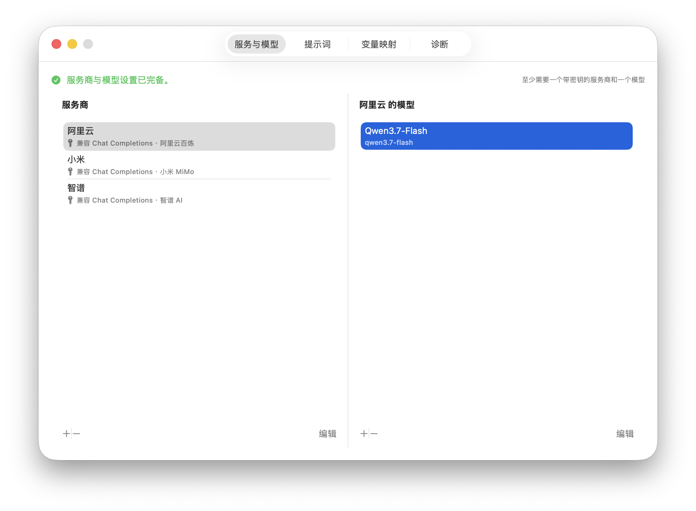

# AI 翻译工具

一个运行在 macOS 菜单栏中的 SwiftUI 翻译工具。它把待翻译内容按照可编辑的提示词组装后，发送给 OpenAI Responses API 或兼容 Chat Completions 的服务，并把服务端返回的文本流实时显示在结果区。



## 功能概览

- 菜单栏常驻，不占用 Dock 图标。
- 支持多个服务商和每个服务商下的多个模型。
- 支持 OpenAI Responses API 与兼容 Chat Completions。
- 目前内置 OpenAI、阿里云百炼、智谱 AI、小米 Mimo 的轻量翻译优化方案，主要用于关闭模型的“深度思考”功能。
- 支持流式输出、手动翻译和自动提交。
- 主窗口打开时监视剪贴板，并弹出可点击的快速输入卡片。
- 可自定义目标语言、附加要求和完整翻译提示词。
- API 密钥保存在 macOS 钥匙串，不写入普通设置文件。
- 可按需开启网络诊断日志。

## 系统要求

- macOS 14.0 或更高版本。
- 使用 Xcode 构建时，不需要第三方 Swift Package。
- 一个支持 OpenAI Responses API 或兼容 Chat Completions 的模型服务。

## 开始使用

1. 用 Xcode 打开 `Translator.xcodeproj`，选择 `Translator` Scheme 后运行。
2. 应用启动后会显示在菜单栏。左键单击菜单栏图标打开主窗口，右键可打开主窗口、设置或退出应用。
3. 如果尚未完成配置，应用会自动打开设置窗口。
4. 在“服务与模型”中添加服务商：
   - 填写显示名称。
   - 填写基础网址，可以停在 `/v1`，也可以填写完整接口地址。
   - 选择接口格式和优化方案。
   - 填写 API 密钥。
5. 选择刚添加的服务商，再添加至少一个模型。模型的“真实名称”会原样写入请求的 `model` 字段。
6. 回到主窗口，输入文本、选择目标语言和模型，然后单击中央按钮或按 `⌘↩` 翻译。

服务商和模型均可通过“双击列表项”“右键菜单中的编辑”或列表下方的“编辑”按钮修改。



## 常见服务配置

### OpenAI

- 基础网址：`https://api.openai.com/v1`
- 接口格式：优先选择 `OpenAI Responses API`
- 优化方案：`OpenAI`
- 翻译任务优化：建议开启

应用会在 Responses 请求中加入 `reasoning.effort = none`；如果使用 Chat Completions，则加入 `reasoning_effort = none`。不接受该参数的模型会触发一次不带优化参数的自动重试。

### 阿里云百炼工作空间

- 基础网址：`https://{WorkspaceId}.cn-beijing.maas.aliyuncs.com/compatible-mode/v1`
- 接口格式：`兼容 Chat Completions`
- 优化方案：`阿里云百炼`
- 翻译任务优化：建议开启

应用会自动补全 `/chat/completions`，并加入 `enable_thinking = false`，避免混合思考模型先进行较长时间的深度推理、最后才集中返回译文。Responses API 也受支持，对应参数为 `reasoning.effort = none`。

### 智谱 AI

- 接口格式：建议使用 `兼容 Chat Completions`
- 优化方案：`智谱 AI`
- 翻译任务优化：建议开启

Chat Completions 请求会加入 `thinking.type = disabled`。当前没有为智谱 Responses API 注入专用参数。

对于代理、聚合平台或未知的 OpenAI 兼容服务，请选择“通用 OpenAI 兼容”。该方案只发送必要字段，兼容性最高。

### 小米 Mimo

与阿里云百炼类似。

## 翻译与剪贴板行为

- 手动提交：单击中央翻译按钮或按 `⌘↩`。
- 自动提交：停止输入 2 秒后开始 5 秒倒计时；期间继续编辑会取消并重新等待。
- 剪贴板：仅在主窗口可见时，每 0.6 秒检查一次变化。发现新的非空文本后，会在输入区底部显示快速输入卡片。
- 复制译文：复制动作会标记当前剪贴板版本，避免应用把自己刚复制的译文再次作为输入提示。
- 流式显示：客户端收到服务端的译文片段后立即追加。片段大小由服务端决定，短译文可能在一次界面刷新内完成；应用不会人为加入“打字机”延迟。

## 提示词与变量

提示词支持三个系统变量：

- `{{target_language}}`：目标语言映射值。
- `{{addition}}`：附加要求映射值。
- `{{input}}`：待翻译文本。

三个变量必须各出现一次。默认模板还要求 `<translate>` 与 `</translate>` 各出现两次：第一组出现在规则说明中，第二组包围实际输入。设置界面会即时校验模板，也可以恢复默认模板。

## 诊断日志

日志默认关闭。需要排查接口兼容问题时，在“设置 → 诊断”中开启“输出网络诊断日志”。设置页面会显示当前应用实际使用的完整目录。

启用 App Sandbox 后，通常位于：

```text
~/Library/Containers/AI.Translator/Data/Library/Logs/AI.Translator/
```

目录中最多保留当前日志和上一份轮换日志：

- `network-diagnostics.log`
- `network-diagnostics.previous.log`

单个日志超过 4 MB 后轮换。关闭开关只停止后续写入，不删除现有文件。正常日志不会记录 API 密钥、完整提示词或成功响应的正文，只记录事件结构与文本长度；流式事件解析失败时，为了排错会记录对应原始事件，其中可能含有服务端返回的文本。

## 数据与隐私

- API 密钥：存储在 macOS 钥匙串，服务名为 `AI.Translator.ProviderAPIKey`，账号为服务商 UUID。
- 普通设置：通过 `UserDefaults` 保存，键名为 `translator.app-settings.v1`。
- 网络请求：源文本会进入提示词并发送给用户选择的服务商。
- 日志：默认关闭；开启前请阅读上一节的隐私说明。

## 开发者入口

- [架构、目录、状态流转与构建说明](docs/DEVELOPMENT.md)
- [服务商优化、阿里云调试记录与扩展清单](docs/PROVIDER_OPTIMIZATION.md)
- [截图文件说明](docs/images/README.md)

## 当前边界

- 当前没有自动化 UI 测试 Target。
- 服务商优化只调整少量请求参数，不负责发现模型列表或验证厂商账户权限。
- 自动回退仅针对优化请求收到 HTTP 400 或 422 的情况；鉴权、限流和服务器故障会原样报告。
- “逐词输出”取决于服务端如何切分流式片段，客户端只保证收到后立即显示。
